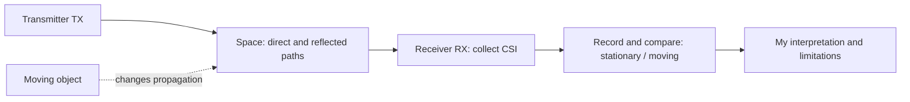

# WiFi-CSI

[Full workflow: standalone firmware and movement comparison](docs/workflow-plan.md) (firmware deployed; controlled protocol not fully executed).

**Receiver-focused learning notes and personal reflections on Wi-Fi CSI.**

[中文](README.md) | English

I want to understand how wireless signals reflect changes in a space through a simple transmitter–receiver setup. A transmitter sends Wi-Fi traffic through the environment, a receiver collects CSI, and stationary and moving conditions are compared to see whether motion in the propagation region produces observable changes.

This repository presents my understanding, design choices, and learning process. My current aim is to explain the basic idea and the evidence behind observations, rather than pursue advanced algorithms or a complete product.

## My understanding

I see CSI as a way for the receiver to observe the wireless channel. Wi-Fi carries data, but also provides an opportunity to examine how the environment affects propagation. CSI describes channel characteristics, including amplitude and phase; it is not an image of an object. [Official introduction](https://github.com/espressif/esp-csi)

My first question is: **With the transmitter and receiver kept in fixed positions, can I repeatedly observe a difference between a stationary environment and one with a moving object?** Understanding that difference and its limits is my starting point.

The region “between” the devices includes the space affecting radio propagation. Signals can arrive through multiple paths, so a change on one link does not establish that an object is at a particular point on the straight line between the devices. I plan to compare movement near that line with movement to its side.

## Learning framework

| Part | Role in this project |
| --- | --- |
| Transmitter | Supplies Wi-Fi traffic for observation; a router can serve this role initially |
| Propagation space | Contains the devices and motion; placement and conditions are recorded |
| Receiver | An ESP32-S3 is the intended learning platform for collecting and reporting CSI |
| Computer | Saves observations, displays data, and supports writing the learning notes |

“Receiver-focused” describes the learning emphasis. In the historical router Ping setup, the ESP32 also sends Ping requests to elicit replies; it is not a radio that never transmits. Official examples also cover separate sending and receiving roles if a dedicated transmitter is needed later. [ESP-CSI examples](https://github.com/espressif/esp-csi/tree/master/examples/get-started)

## Reading guide

1. [My perspective](docs/perspective.md): how I understand the technology and why I narrowed the scope.
2. [System framework](docs/framework.md): node roles, observations, and output limits.
3. [Simple experiment](docs/experiment.md): stationary and moving comparisons.
4. [Observation template](notes/observation-template.md): facts, interpretations, and questions.
5. [Origin and status](docs/origin-and-status.md): the relationship to earlier work.

All linked notes contain Chinese and English versions.

## Current status

2026-10-14: standalone-0.1.0 was built, flashed and checked for 10/20/30 seconds with no Vision waits. Nine prompted trials were recorded, but position/orientation changed during them. They are exploratory observations, not evidence of controlled small/large classification accuracy.

Read [my field observations and interpretation](notes/2026-10-14-field-reflection.md): stronger responses near the receiver and at its front, and no obvious effect from the tested sounds. These qualitative observations concern this setup, not universal rules. [Plots and statistics](reports/motion-pilot-2026-10-13/report.md) show the data and label limitations. Damage sensing through controlled mechanical excitation remains an untested hypothesis.

[Firmware and reproducibility limits](firmware/README.md) · [Deployment verification](notes/2026-10-14-deployment.md)

A historical record dated 2026-09-30 reports successful Wi-Fi connection, router Ping/CSI basic sampling, and a manual Fake-trigger entry point. Reliable real-motion detection was not verified. The 216 records over 18 seconds were application-level diagnostic messages, not a measured raw CSI sampling rate or detection accuracy.

This learning topic has been separated from the earlier CSI-to-camera workflow. Camera recognition, UART event handoff, pan-tilt control, and the desktop assistant are outside its learning goals. Historical source is preserved; COM4 now runs the standalone firmware.

## References

- [Espressif ESP-CSI](https://github.com/espressif/esp-csi): introduction and examples.
- [ESP-IDF Wi-Fi documentation](https://docs.espressif.com/projects/esp-idf/en/stable/esp32s3/api-guides/wifi-driver/index.html): official entry point for CSI configuration and receiver interfaces.

Technical sources and personal interpretations are recorded separately. Planned experiments are not presented as completed results.
