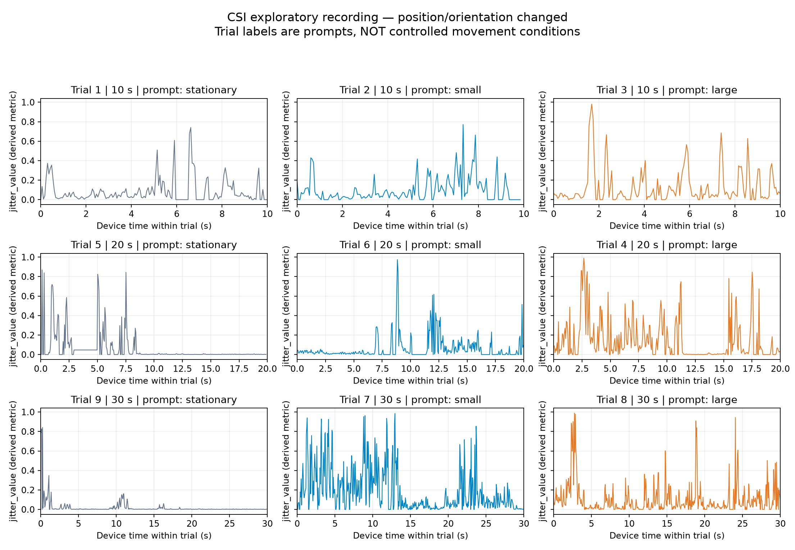

# WiFi-CSI: My exploration and conclusions

[中文](README.md) | English

**This project helped me see that Wi-Fi CSI can reveal changes associated with motion, but observing a fluctuation is a long way from accurately explaining the movement behind it.**

This is a technology learning project built around an ESP32-S3 receiver. Its focus is my understanding and judgment after hands-on exploration, rather than a finished detection product or an advanced algorithm research project.

## My conclusion

My tests suggest some feasibility, but too many factors affect the response. Movement location, receiver orientation and the action itself all influence the observed fluctuations. From the current output alone, I cannot tell whether a change comes from movement near the transmitter or near the receiver, nor can I directly interpret response magnitude as movement magnitude.

**For now, I see more value in using this setup to observe whether motion or a change of state occurs under defined conditions. I remain cautious about using it to identify location, movement magnitude and multiple object characteristics accurately at the same time.** This is my judgment about the tested setup, not a universal limit on CSI technology.

## How I explored the question

My initial question was not how many records the receiver could collect. I wanted to know whether large and small movements would produce distinguishable results, or whether both would simply appear as fluctuations or an `ACTIVE` state.

The project was separated from an earlier CSI-to-camera workflow. After removing the camera, I used a newly deployed standalone CSI receiver firmware and observed changes in 10-, 20- and 30-second windows. During the actual trials, I also changed movement location and receiver orientation, and tried sound and ambient noise.

| Comparison I tried | What I observed | What it suggested to me |
| --- | --- | --- |
| Near the transmitter versus near the receiver | Fluctuations were noticeably smaller near the transmitter | Response depends on location, so its magnitude alone cannot identify the size of a movement |
| Receiver front versus rear | The response at the front was noticeably stronger | Device placement and orientation also affect the result |
| Sound and ambient noise | The effect was barely apparent under the tested conditions | These sound tests produced no obvious change, but do not rule out other environmental influences |

This shifted my attention from “can it detect movement?” to “once it detects a change, can it tell what caused it?” The latter is the main limitation I see in this setup.

## Why I do not claim successful movement-size recognition

I changed position or orientation during the nine trials. Consequently, action, position and direction are mixed together. This recording cannot validate small/large classification under fixed conditions.

The `stationary`, `small` and `large` labels in the figures are prompts shown by the interface, not independently controlled ground-truth classes. I retain the plots to show the changes that actually occurred, without interpreting a larger peak as proof of a larger action.

[See the plots, distributions and statistics](reports/motion-pilot-2026-10-13/report.md). The values are derived receiver diagnostics, not object displacement. Changes in location, orientation and sound were not separately timestamped, so I do not assign a particular segment to one of these factors without evidence.

## An idea from the exploration: damage sensing through induced vibration

By damage detection, I mean making an object vibrate slightly, rather than inspecting a stationary object and declaring whether it is damaged.

My idea is to apply a repeatable small excitation, observe vibration responses at different parts of the object, estimate features such as vibration frequency and amplitude, and compare them with a healthy reference. Could an abnormal response at one part provide a clue about damage?

I see this as a possible direction for observing state changes in a more clearly defined object and setting. It remains a hypothesis: these experiments did not calibrate displacement, separate the responses of different parts or validate damage detection. Frequency alone does not determine amplitude, and current fluctuation metrics are not measurements of physical vibration amplitude.

## What I want this project to communicate

I want to document how I learned: establish reception, look at real data, change conditions to discover limitations, and form a judgment about where the technology may be useful.

For me, the outcome is a clearer distinction between receiving evidence of change and accurately interpreting that change. I am not extending this project into a complex multi-target system or presenting untested ideas as implemented capabilities.

## Implementation and records

The chain is **router reply transmission → propagation through space → ESP32-S3 CSI reception → computer recording and display**. The receiver sends Ping requests to elicit replies. “Receiver” describes its sensing role, not radio silence.

Standalone firmware `standalone-0.1.0` was flashed and passed 10/20/30-second reception checks with camera-response waiting removed. Public application sources do not include all local dependencies or private configuration; see the firmware notes for reproducibility limits.

- [My exploration and technical perspective](docs/perspective.md)
- [Detailed field observations and vibration hypothesis](notes/2026-10-14-field-reflection.md)
- [Firmware and reproducibility limits](firmware/README.md) · [Deployment verification](notes/2026-10-14-deployment.md)
- [System framework](docs/framework.md) · [Further controlled experiment plan](docs/workflow-plan.md)
- [Origin and historical status](docs/origin-and-status.md) · [Espressif ESP-CSI](https://github.com/espressif/esp-csi)

Updated 2026-10-14. These observations and judgments concern this exploration; unfinished controlled repetitions remain planned work.
