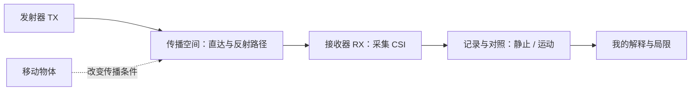

# WiFi-CSI

**以接收端为中心的 Wi-Fi CSI 技术学习与个人理解。**

中文 | [English](README.en.md)

我希望通过一个简单的收发框架，理解无线信号如何反映空间中的变化：框架内有一个发射器，信号经过空间传播，由接收器采集 CSI，再通过静止与运动的对照，观察传播区域中物体移动是否带来可辨别的变化。

这个仓库主要介绍我对技术的理解、设计取舍和学习过程。目标是把基本原理和观察依据说清楚；目前不以深入算法研究或完整产品开发为目标。

## 我的理解

我把 CSI 理解为接收端观察无线信道的一种方式。Wi-Fi 除了传递数据，也让我们有机会观察信号经过环境后发生的变化。CSI 描述信道特征，包含幅度和相位等信息；它不是物体的照片。[官方介绍](https://github.com/espressif/esp-csi)

我关心的第一个问题是：**保持收发器位置不变时，静止环境与物体移动时的接收数据，有没有可以重复观察到的差异？** 对我而言，先理解这个差异及其局限，比一开始追求复杂识别更有学习价值。

这里的“中间路程”是无线传播所影响的空间。信号可能经不同路径到达接收器，所以单条链路的变化不足以证明物体位于收发器连线上的某一点。我的实验会包含连线附近和侧方的运动对照，避免把无线感知想成一条光电对射线。

## 学习框架

| 部分 | 在本项目中的角色 |
| --- | --- |
| 发射器 | 提供可用于接收观测的 Wi-Fi 流量；首轮可沿用路由器 |
| 传播空间 | 摆放收发器，记录距离、朝向和物体运动条件 |
| 接收器 | 以 ESP32-S3 为学习对象，采集 CSI 并输出观察数据 |
| 电脑 | 保存记录、显示数据、整理学习结论 |

“接收端为中心”指学习重点。若沿用历史的路由器 Ping 方案，ESP32 仍会发出 Ping 来促使路由器回应，不代表无线电完全不发射。官方也提供独立的发送与接收示例，后续需要固定发射节点时再考虑采用。[ESP-CSI 示例](https://github.com/espressif/esp-csi/tree/master/examples/get-started)

## 读什么

1. [我的技术理解 / My perspective](docs/perspective.md)：我怎么看这项技术，以及为什么收缩范围。
2. [收发框架 / System framework](docs/framework.md)：节点角色、观察对象和输出边界。
3. [简单实验 / Simple experiment](docs/experiment.md)：静止与运动的对照步骤。
4. [观察记录模板 / Observation template](notes/observation-template.md)：分别写事实、解释和疑问。
5. [拆分来源与状态 / Origin and status](docs/origin-and-status.md)：历史工作和本仓库的关系。

## 当前状态

2026-10-13：完成独立学习库的双语文档框架。新框架尚未进行硬件实验，也没有可直接烧录的新固件。

此前项目的 2026-09-30 记录支持 Wi-Fi 连接、路由器 Ping/CSI 基础采样及手动 Fake 触发入口曾通过；不支持真实运动检测可靠性已经验证。历史 18 秒内的 216 条记录是上层诊断消息，不能当作原始 CSI 采样率或识别准确率。

本次从原有 CSI→摄像头路线拆分学习主题。摄像头识别、UART 事件交接、云台与桌面助手不属于这里的学习目标。旧工程与设备固件保持原状。

## 参考

- [Espressif ESP-CSI](https://github.com/espressif/esp-csi)：技术介绍与示例入口。
- [ESP-IDF Wi-Fi 文档](https://docs.espressif.com/projects/esp-idf/en/stable/esp32s3/api-guides/wifi-driver/index.html)：CSI 配置与接收接口的官方说明入口。

技术来源与个人解释分开记录；尚未做过的实验不写成成果。
