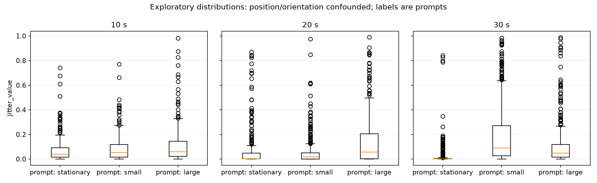

# 多因素探索记录 / Exploratory recording

初始页面确认 / Initial checkbox confirmation: True

**操作者随后确认：九组过程中改变了位置或朝向。原先页面确认不能证明受控标签有效。下表与图中动作名仅为页面提示，不能用来推断大小动作、位置、朝向或时长的独立影响。**
**The operator subsequently reported position/orientation changes within the nine trials. The original checkbox does not establish controlled labels. Condition names are prompts only; no isolated movement, location, orientation or duration effect can be inferred.**
本轮每种动作×时长只有一次，属于初测，不能证明稳定区分能力或准确率。记录的是 jitter 派生指标，不是位移。
One trial per condition/duration: descriptive pilot only, not a repeatability or accuracy claim. Jitter is a derived diagnostic, not displacement.

|页面提示 / Prompt only|时长 s|中位数 / Median|P95|ACTIVE 时间占比|序号缺口|
|---|---:|---:|---:|---:|---:|
|stationary|10|0.039774|0.331134|55.3%|0|
|small|10|0.052285|0.386936|44.4%|0|
|large|10|0.058407|0.512425|36.1%|0|
|stationary|20|0.002724|0.375132|11.3%|0|
|small|20|0.016958|0.285922|41.9%|0|
|large|20|0.056775|0.633224|30.5%|0|
|stationary|30|0.002342|0.087131|8.3%|0|
|small|30|0.089624|0.671543|42.2%|0|
|large|30|0.047548|0.395555|38.0%|0|

## 解释边界 / Interpretation limits

- 若动作标签未确认，以上只按提示时段分组，不解释为真实动作差异。 / Unconfirmed prompts are not ground truth.
- 原计划要求相同部位和节奏，但本轮存在位置/朝向变化，不能隔离动作大小效应。 / Speed, direction and adaptive baseline remain potential influences.
- ACTIVE 时间占比按有效的相邻设备时间间隔加权；超过 250 ms 或非正间隔不计入分母，缺口在统计文件中单列。 / ACTIVE time fraction excludes invalid timing gaps.
- 本轮没有受控干扰开关，不能据此归因外界噪声；也不能把较长窗口的更高峰值单独解释为噪声增加。 / No controlled interference comparison was performed.
- 稳定区分需要重复实验；自动分类需要独立验证轮次。 / Repeatability needs repeated trials; classification needs held-out validation.
